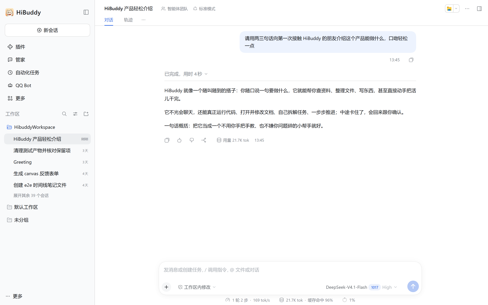
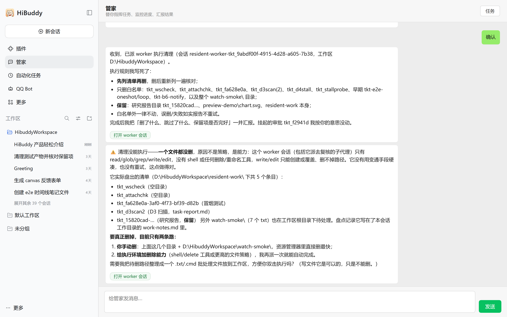
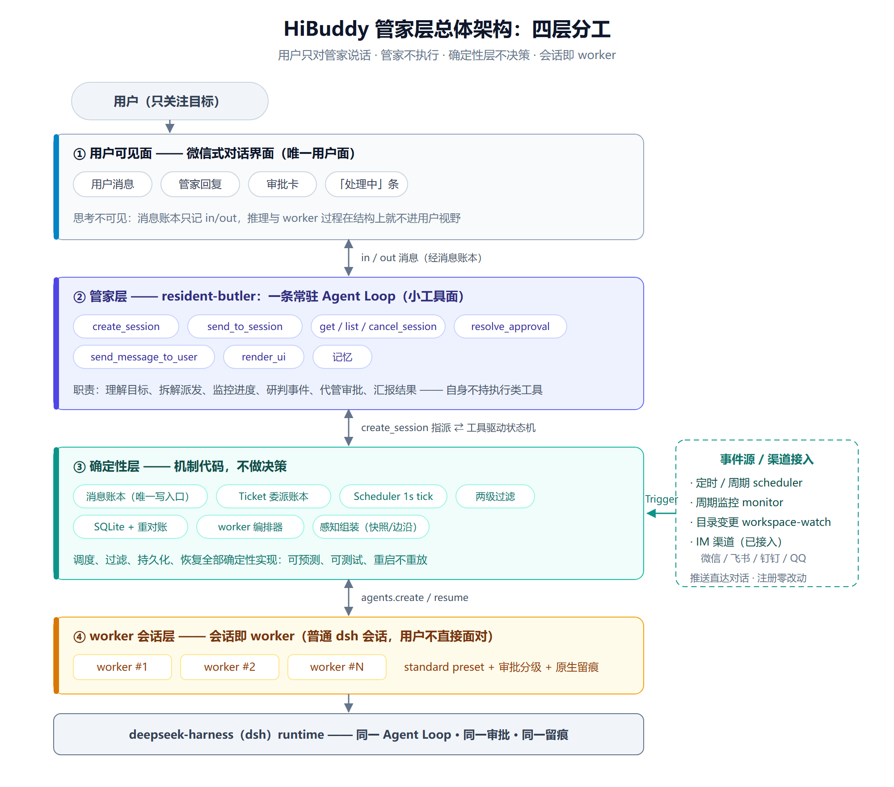

# HiBuddy

> 个人 AI 协作者（personal AI coworker）——不是一个聊天窗口，而是**多 Agent 之上的一层管家**：它替你拆解目标、委派 worker 会话干活、跟进进度、处理消息、代答低危审批，最后在一条微信式对话里向你汇报。

[-blue)](https://github.com/deepseek-ai/deepseek-harness)
[](./package.json)
[](./package.json)

---

## 它长什么样

**一条对话，一切入口。** 用户只对管家说话；消息账本只记 in/out，worker 的推理与过程在结构上进不了用户视野。



**管家面板——委派一线。** 管家会话里可以看到它派发的 worker 会话、执行预览与回执汇总；每个 worker 会话可点开单独查看，审批卡只在真正高危的时刻升级给你。



## 核心能力

- **会话即 worker**：委派 = `create_session` 建独立 dsh 会话（独立上下文/沙箱/审批分级），不是父会话里的 subagent——委派规模可以无限增长，而管家的上下文消耗保持恒定。
- **管家是一条常驻 Agent Loop**：小工具面（create_session / send_to_session / resolve_approval / send_message_to_user…），自身不带执行类工具，职责是理解目标、拆解派发、监控进度、研判事件、汇报结果。
- **确定性层不决策**：调度、过滤、持久化、恢复全部机制化实现（可预测、可测试、重启不重放）；"是否行动"只留给管家的研判单轮。
- **三层次感知**：L0 消息账本（模型上下文组装）、L1 边沿事件（停滞/恢复/监控触发/提问未答）、L2 来源扩展——定时/周期任务、周期监控、目录变更扫描均已落地；**IM 渠道（微信 / 飞书 / 钉钉 / QQ）推送直达管家对话**。
- **两级过滤 + 观察模式**：事件先过"来源启停 + 同源去重"的确定性闸，再由检查会话做条件研判；外部内容一律标记 untrusted 按数据处理。
- **审批分级代管**：L0/L1 低危审批管家代答留痕，L2 与越权操作才弹审批卡，超时 fail-closed。
- **生成式 UI**：组件指令带 revision 做乐观渲染与过期提示，交互回传统一为账本引用格式。

## 架构

四层分工：用户只对管家说话 · 管家不执行 · 确定性层不决策 · 会话即 worker。底座为 [deepseek-harness（dsh）](https://github.com/deepseek-ai/deepseek-harness)官方扩展面（Cordis 插件 / profile / brand），不做 fork。



深度思考与实践总结见 **[《会话即 Worker，注意力即瓶颈》](docs/product/agent-butler-deep-thinking.md)**（含完整架构、感知管线与委派生命周期的示意图）。

## 目录结构

```
├── profile/hibuddy/        # dsh profile 装配清单（bundle 层序 + cordis.patch.yml，非 npm 包）
├── packages/
│   ├── resident/           # @hibuddy/resident —— 常驻管家（butler loop / 调度 / 感知 / 委派账本）
│   ├── coworker/           # @hibuddy/coworker —— 工具与人设
│   ├── web-ui/             # @hibuddy/web-ui —— Web UI 定制（消息账本 / 审批卡 / 生成式 UI）
│   ├── brand/              # @hibuddy/brand —— 品牌资源
│   └── ag-ui-bridge/       # @hibuddy/ag-ui-bridge —— 可选 AG-UI 调试桥
├── desktop/                # Electron 桌面端（自建壳 + 宿进程内嵌 dsh runtime）
├── scripts/                # 构建 / profile 同步等工具脚本
├── tests/e2e/              # 跨端 E2E（Playwright）
└── docs/                   # 全部文档（架构 / ADR / 设计 / 调研，入口 docs/README.md）
```

## 快速开始

前置要求：Node.js ≥ 24.9、pnpm ≥ 12。

```bash
# 1. 安装依赖（首次若提示 ignored builds，执行 pnpm approve-builds --all）
pnpm install

# 2. 同步 profile 到 $DSH_HOME/profiles/hibuddy（Windows 下建立 junction）
pnpm profile:sync

# 3. 启动（输出带 token 的本机访问 URL）
pnpm dsh --profile hibuddy
```

启动日志中的 `dsh web: http://127.0.0.1:<port>/?token=...` 即本机访问入口。模型供应商在 profile 的 `cordis.patch.yml` 中配置（默认 deepseek-official / deepseek-flash，可替换为任意 dsh 支持的供应商路由）。

**桌面端**：`desktop/shell` 经 electron-builder 打 NSIS 安装包（如 `HiBuddy-Setup-0.3.2.exe`），内嵌完整 dsh runtime，装完即用、无外部依赖。

## 文档

| 入口 | 内容 |
|---|---|
| [docs/README.md](docs/README.md) | 全库文档索引 |
| [docs/architecture/](docs/architecture/) | 系统总体架构与分层 |
| [docs/decisions/](docs/decisions/) | ADR 决策记录（定位 / 会话形态 / 感知源等） |
| [docs/module-design/](docs/module-design/) | 常驻层、管家等模块详细设计 |
| [docs/product/](docs/product/) | 产品文档与深度思考文章 |

## License

MIT（见 [package.json](package.json) 的 `license` 字段）
