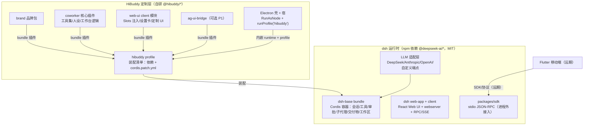

# HiBuddy 系统架构与技术方案

> 依据：[需求文档 PRD](../product/requirements.md)。总体路线决策见 [ADR-003](../decisions/ADR-003-dsh-based-customization.md)（基于 dsh 深度定制，取代 ADR-002 的适配器路线）。
> 参考项目清单见 [ag-ui-research.md](../references/ag-ui-research.md)；dsh 桌面端剖析见 [dsh-desktop-analysis.md](../references/dsh-desktop-analysis.md)；dsh Web/CLI 剖析见 [dsh-web-cli-analysis.md](../references/dsh-web-cli-analysis.md)。
> 文中标注 [ADR-pending] 的选型在编码前需落 ADR（docs/decisions/）。

## 1. 架构原则

1. **底座优先，不造轮子**：会话、工具、审批、子代理、交付物、工作区、Web UI 等能力直接使用 dsh 现成子系统；HiBuddy 只做产品差异化定制。
2. **官方扩展路径优先**：定制一律走 dsh 官方扩展面（Cordis 插件、bundle、cordis.patch.yml、client-modules、Slots、brand 包）；不改 dsh 源码，**fork 仅当定制点落在其私有装配层时才评估**（目前无此需求）。
3. **产品即 profile + 插件集**：HiBuddy 的"服务端"不是自建进程，而是 `hibuddy` profile（装配清单）+ `@hibuddy/*` 插件包；同一 profile 被桌面宿、Web 部署、移动端共同消费。
4. **本地优先**：数据与密钥不出本机（`$DSH_HOME` 本地布局）；服务端无多租户概念（P0）。
5. **安全边界显式化**：工具审批（dsh approval answerer 之上做风险分级）、生成式 UI 沙盒、密钥存储三层边界各自独立实现、独立测试。
6. **升级友好**：对 dsh 的耦合点全部显式登记（覆盖的 patch 行、依赖的内部 API），保证 dsh 版本升级可控（`engines.dsh` SemVer 闸 + 升级冒烟测试）。

## 2. 总体架构



- **dsh 是依赖不是 fork**：以 npm scoped 包（`@deepseek-ai/*`）引入；`thirdparty/deepseek-harness` 仅作源码对照参考。
- **HiBuddy 前端直接复用 dsh client**（React），定制以 client 模块插件与 Slots 注入增量实现；品牌经官方 brand 包路径替换（`sidebar.brand.mark/name`、hero slot），不 fork 前端。

### 2.1 两种部署形态，同一个 profile

| 形态 | 运行时位置 | 前端载体 | 说明 |
|---|---|---|---|
| 桌面端 | 自建 Electron **壳 + 宿分离**：宿进程内嵌 dsh runtime，`runProfile('hibuddy')` 启动（127.0.0.1 随机端口） | 渲染进程加载 dsh web 前端 + `@hibuddy/web-ui` 插件（IPC 桥注入） | 复刻 dsh apps/desktop + desktop-host 模式（见 [dsh-desktop-analysis.md](../references/dsh-desktop-analysis.md)）；应用关闭则 runtime 退出（PRD FR-09）；profile 名 `hibuddy`（dsh desktop-host 硬编码 `'dsh'`，自建宿规避） |
| Web 端 | `dsh web`（dsh 原生单进程：webserver + RPC/SSE + 前端 dist） | 同一 dsh web 前端 + HiBuddy client 插件 | 自部署，P0 单用户令牌；断线重连用 dsh client 原生语义（seq 校验 + opening snapshot + page() 修 gap） |

两端跑**同一个 `hibuddy` profile**——插件、工具、模型配置、会话数据模型完全一致（PRD 双端一致）。

### 2.2 启动编排（dsh 原生机制，直接复用）

`dsh web`（Web 端）与桌面宿共用 dsh boot 链路（见 [dsh-web-cli-analysis.md](../references/dsh-web-cli-analysis.md) §2/§3）：分层 patch 组合（bundle→profile→home→CLI overlay）→ 插件模块解析冻结 → webserver 监听（loopback 默认、拒绝 wildcard）→ connection 行 RPC 网关（launch token 换签名 cookie）→ web-runtime 定位前端 dist → 全树 settle → `appReady` 门闩 → 打印 tokenized URL / 通知窗口加载。HiBuddy 不重写编排，只提供 profile 与插件。

## 3. 技术栈

| 层 | 选型 | 说明 |
|---|---|---|
| Agent 底座 | **deepseek-harness（`@deepseek-ai/*` npm 包，MIT）** | Cordis 插件容器 + 会话/工具/审批/子代理/交付物/工作区子系统；Node >= 24.9；版本锁定策略见 §13 |
| 前端 | dsh client（React）+ `@hibuddy/web-ui` client 模块插件 | 不自建前端工程；HiBuddy UI 以 client 模块 + Slots 增量注入（dsh web-app 的 dist 由 dsh webserver serve，`base:'./'`） |
| 桌面壳 | Electron（自建壳 + 宿） | 壳+宿分离、`ELECTRON_RUN_AS_NODE=1`、`--port 0`、`hibuddy-app://` 特权协议、细分沙箱 preload（复刻 dsh desktop 方案，[ADR-pending]） |
| 移动端 | Flutter | 远期；经 dsh `packages/sdk`（stdio JSON-RPC）或 HTTP/SSE 接入同一 runtime |
| 插件开发 | TypeScript；bundle 形态（manifest 声明 `dsh.bundle.patch` + JS 入口 + 可选 `dsh.client` 导出） | 包命名 `@hibuddy/*`；`engines.dsh` 声明兼容范围 |
| 包管理 | pnpm workspace monorepo | profile 以 `workspace:*` 链接 HiBuddy 插件（开发态） |
| 测试 | vitest（插件单测/契约）+ Playwright（Web E2E）+ Electron driver（桌面 E2E）；模型以 dsh 自定义端点/mock 驱动 | |

## 4. 协议与会话模型（dsh 原生）

- **会话真源**：dsh SessionEvent 仅追加日志（13 种事件变体、单调 seq、per-session JSONL + Zstd 压缩 + flush 检查点/崩溃恢复）；检索索引用 SQLite。
- **传输**：dsh webserver 的 RPC 网关（`/api`）+ SSE 事件流；dsh client 内置重连语义（seq 闭区间校验、opening snapshot 原子替换、page() 补缺口）——直接满足 PRD FR-09"重开页面恢复状态"。
- **AG-UI 定位**：P0 **不建** AG-UI 统一端点——dsh 原生协议即 HiBuddy 的统一协议，前端复用 dsh client。AG-UI 兼容桥（`@hibuddy/ag-ui-bridge`，把 dsh 事件流转 AG-UI 事件）为 **P1 可选插件**，保留接入 AG-UI 生态（第三方前端/Agent）的口子；事件映射表存量见 [ADR-002](../decisions/ADR-002-agent-runtime-selection.md)（已归档）。

## 5. HiBuddy 定制层设计

### 5.1 profile 装配（`profile/hibuddy/`）

产品的"装配清单"，dsh 加载的最小单元：

- `package.json`：依赖 `@deepseek-ai/dsh-base`、`@deepseek-ai/dsh-web-app`（等官方 bundle）+ `@hibuddy/*`（workspace 链接或 npm 安装）；`dsh.profile.bundles` 声明启用顺序。
- `cordis.patch.yml`：profile 层装配 patch——以 `insert` 为主（HiBuddy 自己的行），覆盖官方行需注释登记（被覆盖行现值 + dsh 版本）；`disabled: true` 关闭不需要的官方行（dsh 无删除语义）。
- 部署即分发：桌面端随宿进程打包 profile 目录；Web 端以目录形式自部署；用户级微调走 `$DSH_HOME/cordis.patch.yml` 与 CLI `--patch`（dsh 分层语义）。

### 5.2 插件集（均为 dsh bundle 形态）

| 包 | 职责 | 依赖的 dsh 扩展面 |
|---|---|---|
| `@hibuddy/brand` | 品牌包：名称/logo/标题/侧边栏 mark | brand slots（`sidebar.brand.mark/name`、hero slot）、`DSH_CLIENT_TITLE` |
| `@hibuddy/coworker` | 个人工作伙伴核心：内置工具（日程/文件/检索等，随 PRD 细化）、人设与系统提示词、工作台领域逻辑 | `ctx.tools.register`、profile patch config（插件 Schema 贡献配置）、事件 |
| `@hibuddy/web-ui` | Web UI 定制：设置卡、工作台面板、审批交互增强 | `dsh.client:{platform:'web'}` client 模块 + `ctx.slots.inject()` |
| `@hibuddy/ag-ui-bridge`（P1 可选） | dsh 事件流 → AG-UI 事件转换端点 | 自有 surface（web-transport 插件注册路由）+ SessionEvent 订阅 |

### 5.3 桌面端（`desktop/`）

自建 Electron **壳 + 宿**（复刻 dsh 模式，见 [dsh-desktop-analysis.md](../references/dsh-desktop-analysis.md)）：

- `@hibuddy/desktop-shell`：Electron 主进程——窗口/托盘/通知、`hibuddy-app://` 特权协议（静态资源本地服务 + 认证转发）、细分沙箱 preload、宿进程生命周期（spawn/quit-inspection）。
- `@hibuddy/desktop-host`：`ELECTRON_RUN_AS_NODE=1` 宿进程——内嵌 dsh runtime，`runProfile('hibuddy')` 启动，IPC 应答 ready/fatal/quit；`--port 0` 取 OS 随机端口回传壳。

## 6. 工具执行与审批

dsh 已有完整审批子系统（approval request waterfall、answerer 挂接、fail-closed、审计入 session log）。HiBuddy 的定制点：

1. **风险分级（PRD SR-01）**：在 HiBuddy 的 approval answerer 插件中实现 L0 自动放行 / L1/L2 挂起待批；分级规则随工具注册声明。
2. **免再询授权**：会话×工具×等级的授权记忆，存 HiBuddy 插件配置（dsh settings 命名空间）。
3. **拒绝反馈**：answerer 拒绝即向运行时注入"用户拒绝"结果（dsh 审批语义原生支持）。
4. L1 代码执行复用 dsh sandbox 子系统，能力不足再补沙盒策略 [ADR-pending]。

## 7. 生成式 UI 链路

- **产出**：dsh 生态的生成式 UI 路线（ui4a harness：让模型直接写前端代码、运行时强制边界，参考 MindLab-Research/dsh-generative-ui）与 dsh client 组件渲染底座结合；产出格式选型 [ADR-pending：ui4a vs 组件指令]。
- **渲染**：复用 dsh client 的隔离渲染边界 + `@hibuddy/web-ui` 注入的画布容器；沙盒内无网络与密钥访问（SR-02）。
- **交互回传**：沙盒事件经 client 模块上行（dsh 事件流），进入会话日志参与下一轮上下文。
- **版本与驻留**：画布实体挂接 dsh 会话/交付物子系统（deliverables），恢复语义随 dsh 会话恢复（PRD FR-04）。

## 8. Provider 层（BYOK）

- **dsh 原生多 Provider**：内置目录含 anthropic/openai/moonshotai/zai 等；"Custom model API" 支持任意 base URL + OpenAI Chat Completions / OpenAI Responses / Anthropic Messages 三协议（profile patch 热生效）——PRD FR-06 的 DeepSeek/OpenAI/Anthropic/自定义端点全部直接覆盖。
- **HiBuddy 补充**：`@hibuddy/coworker` 内置 HiBuddy 推荐的 Provider 预设（DeepSeek 官方 + 国内可达端点）；需要新协议时按 dsh 适配器指南自写（参考其内置 llm-pi-ai——即 pi 的 pi-ai 已被 dsh 吸收为 LLM 适配层）。
- **密钥存储**：dsh `$DSH_HOME/.credentials.yaml`（本地）；桌面端沿用（用户目录即本机），Web 端仅服务端本地（单用户自部署）[ADR-pending：桌面壳是否迁移到 Electron safeStorage]。
- Key 校验与错误归一化由 dsh LLM 层完成，HiBuddy 不重复建设。

## 9. 数据与持久化

| 数据 | 位置 | 说明 |
|---|---|---|
| 会话/消息/Run/工具调用/审批 | dsh：per-session JSONL（真源）+ SQLite 检索索引 | `$DSH_HOME` 本地布局；导出（PRD FR-08）由 dsh 会话数据生成 |
| 交付物/工作区 | dsh deliverables / workspace 子系统 | L1 工具读写边界即 workspace 目录 |
| HiBuddy 定制配置/授权记忆 | dsh settings（插件 Schema 贡献） | 随 profile 分层 |
| 凭证 | `$DSH_HOME/.credentials.yaml` | 见 §8 |

## 10. 仓库结构（pnpm workspace）

### 10.1 workspace 包清单

| 包名 | 路径 | 职责 |
|---|---|---|
| `hibuddy` profile | `profile/hibuddy/` | dsh profile：产品装配清单（依赖 + cordis.patch.yml），非 npm 包 |
| `@hibuddy/brand` | `packages/brand/` | 品牌包（brand slots 占位、标题、图标） |
| `@hibuddy/coworker` | `packages/coworker/` | 核心插件：内置工具、人设、工作台逻辑、审批风险分级 |
| `@hibuddy/web-ui` | `packages/web-ui/` | Web UI 定制：client 模块 + Slots 注入 |
| `@hibuddy/ag-ui-bridge` | `packages/ag-ui-bridge/` | （P1 可选）AG-UI 协议桥 |
| `@hibuddy/desktop-shell` | `desktop/shell/` | Electron 主进程（窗口/协议/IPC/生命周期） |
| `@hibuddy/desktop-host` | `desktop/host/` | RunAsNode 宿进程（内嵌 dsh runtime + runProfile） |
| `@hibuddy/tests` | `tests/` | 契约测试（插件×dsh API 面）、跨端 E2E |

依赖方向（硬约束）：`profile/hibuddy → @deepseek-ai/*（bundle 基座）+ @hibuddy/*（插件）`；`packages/* → dsh 插件 API（@deepseek-ai/*）`；`desktop/host → dsh runtime + profile`；`desktop/shell → desktop/host`。**任何包禁止 import `thirdparty/` 源码**（thirdparty 只读对照）。`docs/` 不纳入 workspace。

### 10.2 根 workspace 配置（随首次开发创建）

```yaml
# pnpm-workspace.yaml
packages:
  - profile/hibuddy
  - packages/*
  - desktop/*
  - tests
```

### 10.3 目录明细

```
profile/
  hibuddy/            # dsh profile「hibuddy」：package.json（依赖+bundles）+ cordis.patch.yml
packages/
  brand/              # @hibuddy/brand
  coworker/           # @hibuddy/coworker
  web-ui/             # @hibuddy/web-ui
  ag-ui-bridge/       # @hibuddy/ag-ui-bridge（P1 可选）
desktop/
  shell/              # @hibuddy/desktop-shell（Electron 主进程）
  host/               # @hibuddy/desktop-host（RunAsNode 宿）
tests/                # @hibuddy/tests
thirdparty/           # 只读参考：dsh 为源码对照 + 其余生态仓
docs/  scripts/
```

## 11. 安全基线

- 桌面 Electron：`contextIsolation: true`、`nodeIntegration: false`、`sandbox: true`、严格 CSP；渲染进程不持密钥（复刻 dsh desktop 配置面）。
- 审批：fail-closed 起步（dsh 审批语义默认），HiBuddy 分级规则显式声明放行范围（SR-01）。
- 生成式 UI 沙盒（SR-02）与工具审批各自独立模块 + 独立测试。
- Web 端 P0 单用户：dsh webserver 安全默认（loopback、拒绝 wildcard、令牌换签名 cookie）+ 部署参数确认 [ADR-pending]。

## 12. 测试策略

1. **插件契约测试**：`@hibuddy/*` 对 dsh 扩展面（tools/approval/slots/client 模块）的调用契约；以 thirdparty dsh 源码为行为对照。
2. **profile 装配测试**：`hibuddy` profile 可被 dsh boot 成功加载（`--dump-config` 断言组合树）、patch 覆盖行为符合登记。
3. **升级冒烟**：dsh 新版本发布时跑全套（见 §13 版本策略）。
4. **E2E**：Web（Playwright，`dsh web --profile hibuddy`）+ 桌面（Electron driver）；模型以自定义端点 mock 驱动，保证离线可测。

## 13. 风险与应对

| 风险 | 应对 |
|---|---|
| dsh 处于 alpha（v0.2.2-alpha.2），API/协议可能变动 | `engines.dsh` SemVer 闸锁定兼容范围；升级流程 = 读 changelog → diff 覆盖行现值 → 跑升级冒烟 → 更新登记；锁定具体版本于 profile 依赖 |
| 覆盖官方 patch 行在升级时易碎 | 纪律：优先 insert 自己的行/插件 config；必须覆盖时在 patch 注释记录被覆盖行的官方现值与 dsh 版本（§5.1） |
| 前端深度改造超出 Slots 能力 | 先 brand + client 模块 + Slots；确需整层替换时评估自建 surface bundle（仿 dsh-web-app 装配）成本后再决策 [ADR-pending] |
| dsh 单点上游 | MIT 允许 fork 兜底；thirdparty 快照保留源码对照能力 |
| desktop-host 硬编码 profile 'dsh' | 自建宿进程用 `hibuddy` profile（本就是自建范围） |

## 14. 编码前需落地的 ADR 清单

| 编号建议 | 主题 |
|---|---|
| ~~ADR-001~~ | 不再落地：AG-UI 统一协议取消（dsh 原生协议即统一协议；AG-UI 桥为 P1 可选，见 ADR-003 §3.1） |
| ~~ADR-002~~ | 已 superseded：[ADR-002](../decisions/ADR-002-agent-runtime-selection.md)（被 ADR-003 取代） |
| ~~ADR-003~~ | 已落：[ADR-003-dsh-based-customization.md](../decisions/ADR-003-dsh-based-customization.md)（基于 dsh 深度定制的总体路线） |
| ADR-004 | 桌面端壳+宿实现与品牌化细节（进程模型/协议拦截/自动更新/打包签名；输入 [dsh-desktop-analysis.md](../references/dsh-desktop-analysis.md)） |
| ADR-005 | dsh 版本锁定与升级策略（engines.dsh、升级冒烟、覆盖行登记流程） |
| ADR-006 | Web 端部署形态与访问控制确认（dsh webserver 参数、反代、令牌；输入 [dsh-web-cli-analysis.md](../references/dsh-web-cli-analysis.md)） |
| ADR-007 | 生成式 UI 产出格式（ui4a harness vs 组件指令） |
| ADR-008 | L1 代码执行沙盒策略（基于 dsh sandbox 能力确认） |

## 15. thirdparty 参考映射

| 模块 | 参考 |
|---|---|
| **底座本体（npm 依赖）+ 源码对照** | thirdparty/deepseek-harness：扩展面证据见 [ADR-003](../decisions/ADR-003-dsh-based-customization.md) §2；桌面端 [dsh-desktop-analysis.md](../references/dsh-desktop-analysis.md)；Web/CLI [dsh-web-cli-analysis.md](../references/dsh-web-cli-analysis.md) |
| AG-UI 协议（P1 桥的转换目标） | thirdparty/ag-ui |
| 生成式 UI 前端交互样例 | thirdparty/CopilotKit、thirdparty/OpenIntelligentUI |
| 个人 Agent 产品形态与治理 | thirdparty/OpenBot |
| 生成式 UI 协议（对照） | thirdparty/openui |
| 跨框架生成式 UI SDK 思路 | thirdparty/genui-sdk |
| LLM 适配层参照 | thirdparty/pi-mono（pi-ai 已被 dsh 吸收为 packages/llm/llm-pi-ai；自写适配器时对照） |
