# 管家设计图、运行逻辑与交互逻辑

> 本文是 [resident-design](resident-design.md) 的图解补充，决策依据见 [ADR-011](../decisions/ADR-011-butler-conversation-layer.md)。图中标识符与 `packages/resident/src/` 实现一一对应；实现状态为 S7-B 的 B1–B10′ 已交付。

## 1. 静态结构（设计图）

### 1.1 分层与依赖

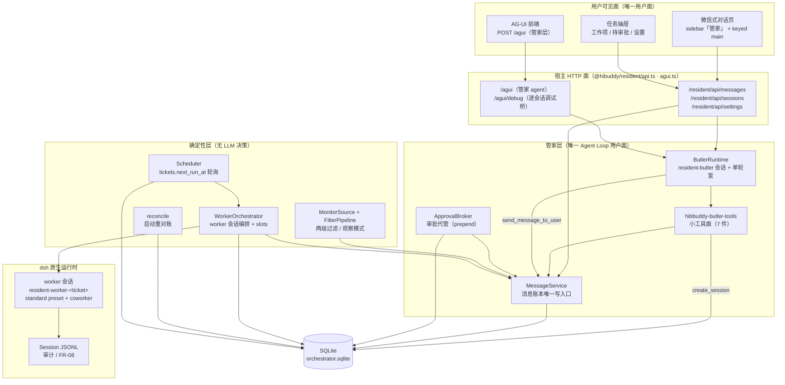

要点：

- **用户只与管家说话**：对话页只渲染账本行（in 用户 / out 管家 / 审批卡），不接触 dsh 会话渲染，因此 assistant 文本、tool call、thinking 不可能泄漏。
- **管家不执行**：`hibbuddy-butler` preset 不含 shell / fs / web / subagent 工具；执行一律 `create_session` 交给普通 dsh 会话。
- **确定性层不做决策**：调度与监控只产生事件信封（入站），是否行动由管家判断。

### 1.2 代码组件映射

| 层 | 文件 | 职责 |
|---|---|---|
| client | `src/client/index.tsx` | 注册 `sidebar.panellist`「管家」入口 + keyed `main` 对话页 |
| client | `src/client/chat-page.tsx` | 气泡流、时间分组、处理中状态条、输入框、审批卡样式、附件预览与图片灯箱 |
| client | `src/client/markdown.tsx` | 管家消息 Markdown 渲染（GFM、表格、代码块、外链新窗口；不启用原始 HTML） |
| client | `src/client/drawer.tsx` | 任务抽屉：工作项、待审批、设置（显式保存/放弃） |
| client | `src/client/api.ts` | 三条数据面请求封装（2s / 3s 轮询）+ 附件预览地址 |
| host | `src/messages.ts` | 账本唯一写路径：先落库、幂等键、免打扰、补投、入站唤醒、出站订阅 |
| host | `src/attachments.ts` | 附件解析：工作区白名单校验、类型/MIME/大小推断、远程 URL 校验 |
| host | `src/butler.ts` | 管家会话、入站队列、单轮串行泵、工具服务面、工作区解析 |
| host | `src/butler-tools.ts` | 8 件工具：`send_message_to_user`（含 Markdown 正文与附件）/ `list_workspaces` / `create_session` / `send_to_session` / `get_session` / `list_sessions` / `cancel_session` / `resolve_approval` |
| host | `src/approvals.ts` | `approval/request` 前置 answerer；审批卡 + 入站审批事件；分级代管与超时 fail-closed |
| host | `src/api.ts` | 对话/工作项/设置/附件读取 HTTP 路由（同一信任栅栏；附件支持 Range） |
| host | `src/agui.ts` | `/agui` 管家层 AG-UI：入站文本 → 管家；出站消息 → `TEXT_MESSAGE_*` |
| host | `src/scheduler.ts` | 1s tick 轮询 `tickets.next_run_at`，迟到阈值 30s |
| host | `src/worker.ts` | worker 会话 create/resume、回合驱动、结果对账、回执入站 |
| host | `src/monitor.ts` / `filter.ts` | 监控检查会话、去重指纹、退避、gate + assessment |
| host | `src/reconcile.ts` | 重启对账：working 续跑/interrupted、待批重投、漏触发补偿 |
| host | `src/store.ts` | SQLite（WAL）schema v3：sources/triggers/tickets(workspace)/runs/worker_sessions/messages/butler_state/settings |

### 1.3 数据模型

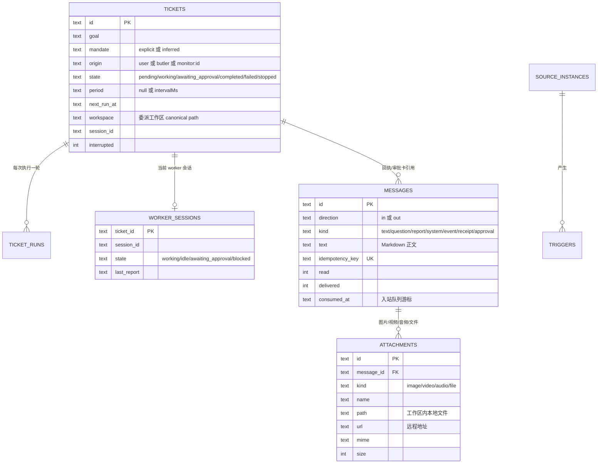

## 2. 运行逻辑

### 2.1 启动装配与恢复

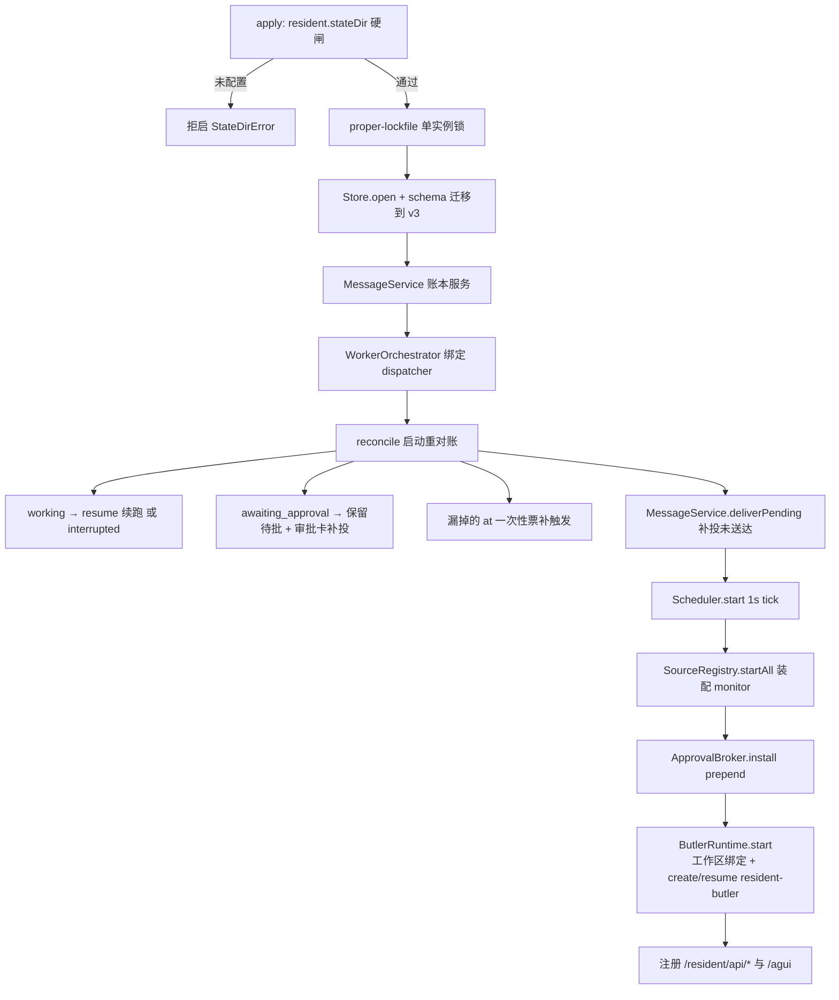

管家启动时的**工作区绑定**：

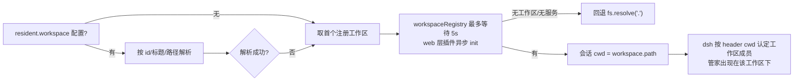

### 2.2 用户消息 → 管家回复（对话主链路）

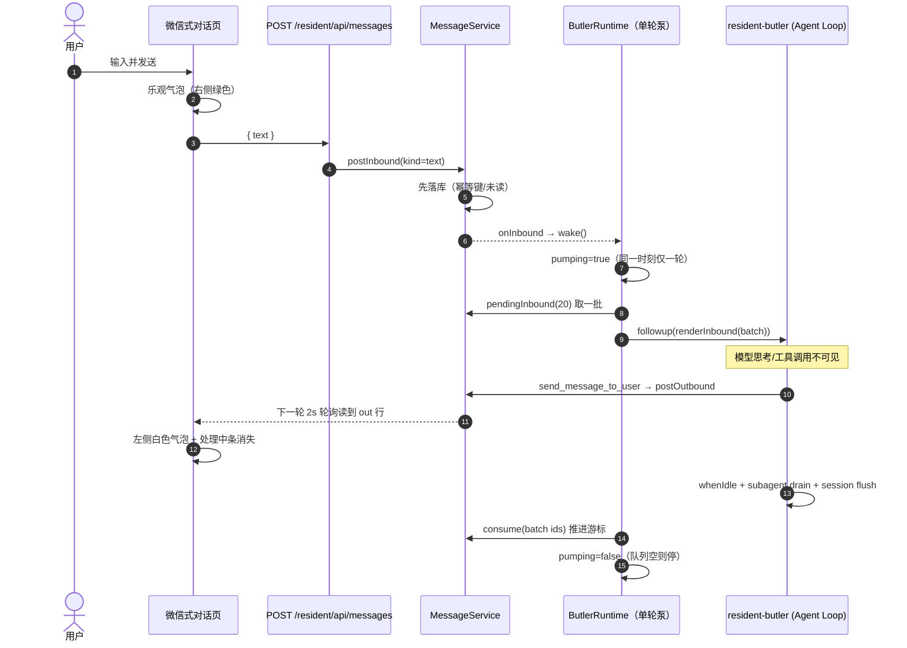

批次与失败语义：

- 每轮最多消费 20 条入站（用户消息 / 事件信封 / 回执 / 审批事件混排），一次周转内最多循环 50 批。
- 轮次失败：**不消费该批**（用户输入不丢），15s 后重试；`butler_state` 保持/恢复 `idle`。
- 事件类入站不直接显示；模型自行判断是否需要用 `send_message_to_user` 告诉用户。

### 2.3 委派：create_session → worker → 回执 → 汇报

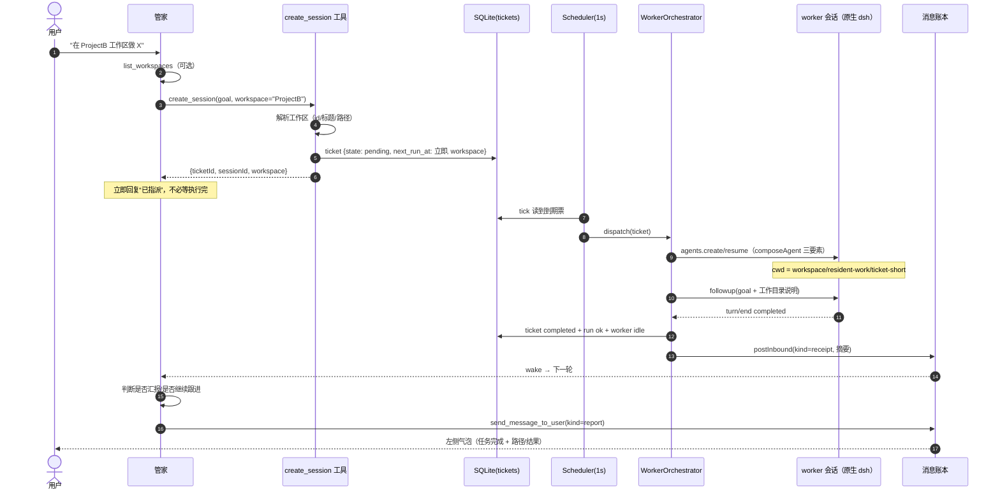

关键约束：

- `create_session` 只写委派账本并返回，**派工在 ≤1 个调度 tick（1s）内发生**；不阻塞管家轮次。
- worker 是普通 dsh 会话（`resident-worker-<shortId>`），沿用 standard preset 的工具面与 coworker 审批分级。
- worker 失败不自动重试：ticket → `failed`，并以入站事件交给管家决定如何向用户交代。
- 工作区目录在派工时消失 → 该轮失败（不静默换目录重建）。

### 2.4 审批：代管 / 升级用户确认

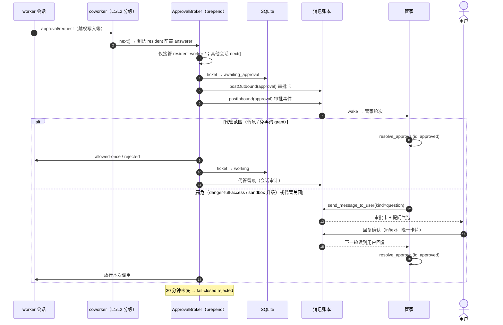

安全口径：

- 代管只能来自**管家轮次内的 `resolve_approval`**，或**用户明示文本回复**（必须晚于审批卡创建时间）；对话界面/AG-UI 不接受无操作来源的自动 resume。
- 设置 `approvalDelegation=false` 时全部审批升级用户确认。
- 每次决定都写入消息账本 + dsh 原生 `approval/decided` 审计（FR-08）。

### 2.5 Ticket 状态机

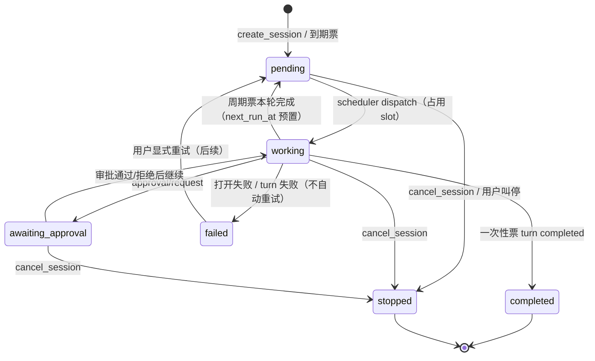

### 2.6 事件源与观察模式

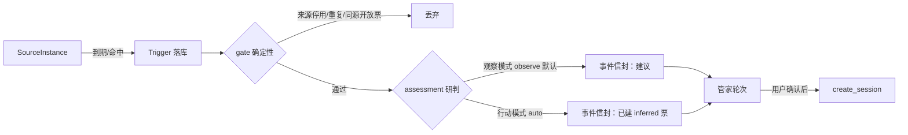

- monitor 每次检查在独立轻量会话中完成；去重指纹由宿主侧读原文 sha256 计算，避免模型措辞不同导致重复触发。
- 连续失败按 `interval × 2^(n-1)` 退避，封顶 30 分钟；3 连败标记 degraded 并以系统事件告知管家。
- 观察模式下命中只投递“建议”信封，管家在对话里汇报，不直接建票。

## 3. 交互逻辑

### 3.1 微信式对话页信息架构

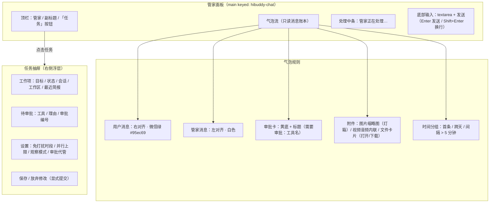

交互语义：

| 交互 | 行为 | 数据来源 |
|---|---|---|
| 打开面板 | 侧边栏「管家」入口 → keyed `main` 全屏页 | `sidebar.panellist` / `main` slot |
| 发送消息 | 乐观追加右侧气泡 → `POST /resident/api/messages` → 轮询换取权威行 | 消息账本 |
| Markdown | 管家气泡按 GFM 渲染（标题/列表/表格/代码/链接），用户气泡保留原样换行 | 账本 `text` 字段 |
| 图片预览 | 缩略图点击 → 全屏灯箱，点击任意处关闭 | `/resident/api/attachment?id=` |
| 视频/音频 | 内联播放器（controls），宿主 Range 206 支持拖动进度 | 同上 |
| 文件卡片 | 扩展名角标 + 大小 + 「打开 / 下载」；下载追加 `download=1` | 同上 |
| 会话跳转 | 气泡（`refs.sessionId`）与抽屉工作项均显示「打开会话」，调用 `uiWorkspace.openSession(sessionId)` 切到该 worker 原生会话 | `/resident/api/sessions` / 账本 `refs` |
| 处理中 | `status.state === 'working'` 时显示状态条，轮次结束消失 | `butler_state` / 泵状态 |
| 审批卡 | `kind=approval` 黄底气泡，展示工具与审批编号 | 账本 out 行（ApprovalBroker 写入） |
| 任务抽屉 | 每 3s 刷新工作项/待审批；设置仅本地草稿，点「保存」才提交 | `/resident/api/sessions`、`/settings` |
| 思考不可见 | 页面无 assistant 文本 / tool call / worker 日志 | 结构性保证：只读账本 |

界面线框（示意）：

```text
┌────────────────────────────────────────────────────────────┐
│ 管家                                              [ 任务 ] │
│ 替你指挥任务、监控进度、汇报结果                            │
├────────────────────────────────────────────────────────────┤
│                        11/9 14:20                          │
│                                      ┌───────────────────┐ │
│                                      │ 在 ProjectB 整理…  │ │ ← 用户（右/绿）
│                                      └───────────────────┘ │
│  ┌───────────────────────────────────┐                     │
│  │ 收到，已指派 worker…              │                     │ ← 管家（左/白）
│  └───────────────────────────────────┘                     │
│  ┌───────────────────────────────────┐                     │
│  │ 需要审批：write                   │                     │ ← 审批卡（黄）
│  │ 写入工作区外路径…  审批编号 apr_… │                     │
│  └───────────────────────────────────┘                     │
│  ┌───────────────────────────────────┐                     │
│  │ 任务完成：…（路径 + 摘要）        │                     │
│  └───────────────────────────────────┘                     │
│  ● 管家正在处理…                                            │
├────────────────────────────────────────────────────────────┤
│ [ 给管家发消息…                                    ] (发送) │
└────────────────────────────────────────────────────────────┘
      点击「任务」→ 右侧抽屉：工作项 | 待审批 | 设置（显式保存）
```

### 3.2 AG-UI（管家层）

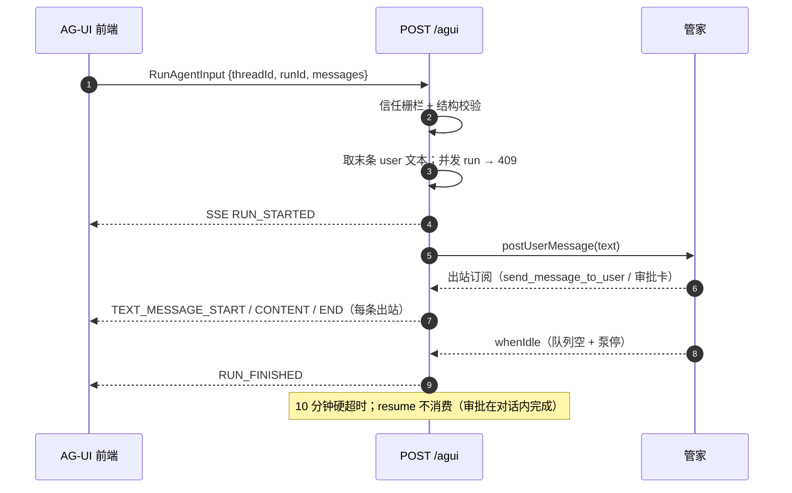

对外语义收敛：

- `threadId` 只是客户端标识；所有请求都进入同一条管家会话（单用户单线程）。
- 输出只有管家的出站消息气泡；worker 拓扑、会话 id、工具调用**不出网**。
- 附件随文本下发为 Markdown（图片 ``，其余 `[name](…)`）；本地文件地址为同源 `/resident/api/attachment?id=`，远程 URL 原样使用。
- 审批不在 AG-UI 层解决：前端只会看到 `kind=approval` 的出站气泡；决定在管家对话内完成。
- 逐会话调试桥保留在 `/agui/debug`（profile patch 配置），产品端点为 `/agui`。

### 3.3 失败、边界与恢复

| 场景 | 行为 | 恢复 |
|---|---|---|
| 管家轮次失败 | 批不消费、日志记录、15s 后重试 | 入站保留 → 下轮重放 |
| 管家会话日志缺失/损坏 | `start()` 捕获 resume 失败 → 新建 `resident-butler` | 账本（用户可见对话）不受影响 |
| 宿主重启 | 单实例锁 + reconcile：working 续跑/标记 interrupted；待批重发审批卡；漏触发补一次 | 重启后自动 |
| worker 会话打开失败 | ticket → failed + 入站事件 | 管家可 `create_session` 重派 |
| 工作区目录消失 | 该轮失败，不重建目录 | 用户确认工作区后重派 |
| 附件路径越界 / 不存在 | 工具调用失败并提示可用工作区，消息不落库 | 管家改用工作区内路径或 URL 重发 |
| 附件文件事后被删 | 读取路由返回 410；气泡正文与文件名仍在 | 让 worker 重新产出后重发 |
| 审批 30 分钟未决 | fail-closed → rejected | 管家/用户重新发起 |
| 免打扰窗 | 出站行照常入账本（对话可见），仅 `delivered` 推送标记延后 | 窗结束补投 |
| AG-UI 客户端断开 | 关闭 SSE、释放 run 槽；服务端轮次继续 | 客户端重连新 run |

## 4. 关键参数

| 参数 | 值 | 位置 |
|---|---|---|
| 调度 tick | 1000 ms | `scheduler.ts` |
| 迟到判定阈值 | 30 s | `scheduler.ts` |
| 管家单轮入站批次 | 20 条 / 最多 50 批 | `butler.ts` |
| 管家轮次失败重试 | 15 s | `butler.ts` |
| worker 并行上限 | 默认 2（设置 0–8） | `worker.ts` / 设置 |
| 审批超时 | 30 min → rejected | `approvals.ts` |
| 监控退避 | `interval × 2^(n-1)`，封顶 30 min，3 连败降级 | `monitor.ts` |
| 对话页轮询 | 2 s | `chat-page.tsx` |
| 抽屉轮询 | 3 s | `drawer.tsx` |
| AG-UI 单 run 上限 | 10 min | `agui.ts` |
| 工作区 registry 等待 | 5 s（异步 init） | `butler.ts` |

## 5. 与其他文档的关系

- 决策与边界：[ADR-011](../decisions/ADR-011-butler-conversation-layer.md)（D1–D11）。
- 模块规格与任务清单：[resident-design](resident-design.md) §2–§13。
- 实施与验收：[implementation-plan](../implementation-plan.md) §S7；证据记录：[progress-report](../progress-report.md) S7-B 段。
