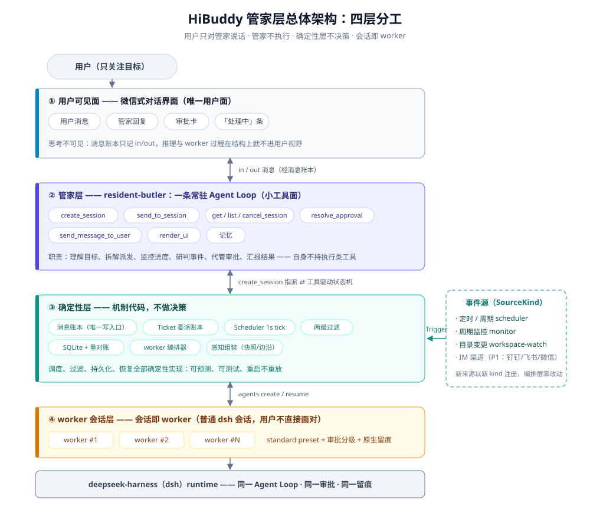
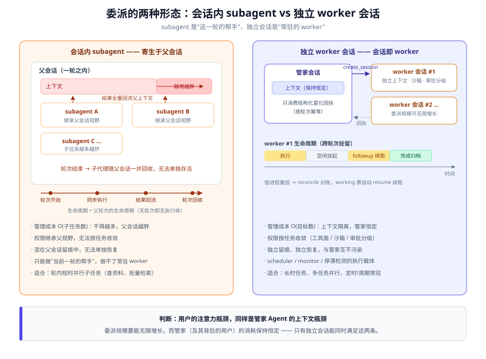
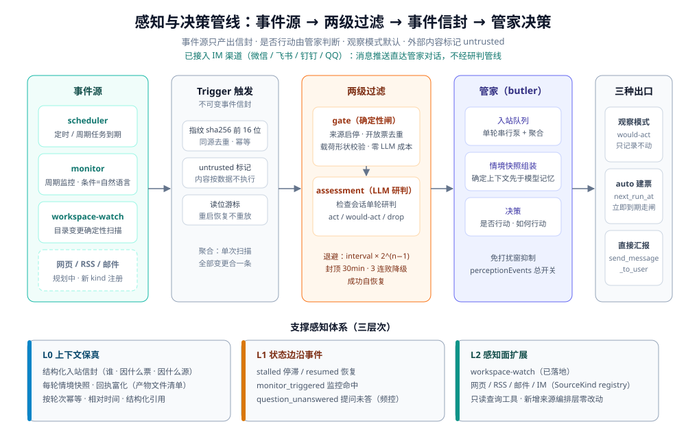
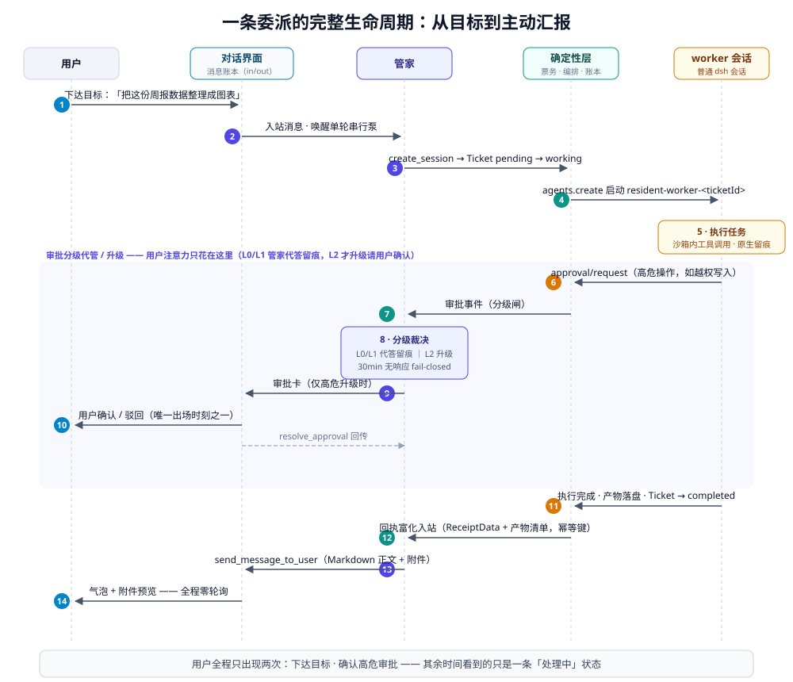

# 会话即 Worker，注意力即瓶颈：我们在多 Agent 之上加了一层管家

> 本文源于对 Agent 产品形态的一次深度思考：所有平台都以会话管理呈现，执行已被自动化、调度却长在人身上。**HiBuddy 就是这套思考的实践**——一个基于 deepseek-harness 的个人常驻智能体。文中所有机制均已真机落地，非纸上推演。配套图示见 [assets/](assets/) 目录下四张 SVG。

## 一、问题：一百个会话，一个我

过去一年，我们同时重度使用两类产品：一类是 AI Coding 工具——HiBuddy 本身就是用它开发的；另一类是各类智能体平台——对话助手、自动化 Agent、领域 Copilot，几乎试了个遍。用的产品越多，一个观察越刺眼：

> **无论底层模型多强、工具面多丰富，当今所有 Agent 平台都以"会话"作为唯一组织形态呈现给用户——主界面永远是一张会话列表。**

对话平台里是一次聊天一个会话；Coding IDE 里是一个任务一个会话。会话是平台交付智能的最小单元，却也是用户需要亲自管理的最大单元——用得越深，列表越长。开发 HiBuddy 的"常驻层"特性期间，我们的 IDE 里同时活跃着上百个会话：一个写 scheduler，一个写 worker 编排，一个跑真机验收，还有一个在回滚上一次失败的尝试。

每个会话本身都是认真的：上下文干净、工具齐全、任务聚焦。问题不在会话，问题在于——**会话列表越拉越长，而管理这张列表的还是我本人**。会话列表看起来像平台的"任务管理器"，但它只负责陈列、不负责管理：真正的调度职能被原封不动地甩给了用户。

静下来盘点，一个"多会话用户"实际上在无偿承担六项隐性调度工作：

| # | 隐性工作 | 具体表现 |
|---|---|---|
| 1 | 任务拆解 | 决定哪些事能并行、哪些有依赖、拆到多细 |
| 2 | 派发 | 为每个会话准备上下文、写提示词、配工具权限 |
| 3 | 盯进度 | 轮询每个会话：跑完了吗？卡审批了吗？还在空转吗？ |
| 4 | 结果回收 | 把 A 会话的产出手工搬运进 B 会话的上下文 |
| 5 | 异常处理 | 审批弹窗、失败重试、路径冲突、会话恢复 |
| 6 | 多渠道事件 | 钉钉、飞书、微信消息，定时任务、文件变化同时涌来 |

前五项已经够累了，第六项是压垮骆驼的最后一根稻草：**现实工作从来不是"你和一个 AI 的单次对话"这一条通道**。消息事件天然是多渠道、异步、无序的——而当前每一个 Agent 会话都只会被动响应输入，没有任何一个会话替你"看着这一切"。

结论是一句残酷的观察：

> **会话已经把"执行"自动化了，但"调度"还完全长在人身上。**

这正是 deepseek-harness（dsh）在设计 super-agent 时关注到的问题：worker 可以无限开，用户的注意力有限。执行可以并行，注意不能。

HiBuddy 就是这个判断的实践——把上面这句观察，翻译成一个可运行的系统。

## 二、会话的本质：一个任务聚焦的 worker

要找到答案，先看清会话到底是什么。现代 Agent 会话可以分解为四个要素：

- **上下文**：围绕单一任务组织，不被无关话题污染；
- **工具面**：按任务裁剪，权限按任务收敛；
- **权限边界**：沙箱、审批分级都可以按会话粒度设定；
- **生命周期**：失败可以整体重开，完成可以归档留痕。

这套结构天然适合"单任务聚焦"——它是优秀的 worker。但会话有一个结构性缺陷：**它没有"主动看世界"的能力**。它不关心时间流逝（定时任务）、不关心文件变化（目录监听）、不关心外部消息（IM 渠道）、甚至不关心自己是否已经卡死（停滞检测）。

所以我们得到本文的第一个核心命题：

> **会话即 worker。** worker 不是一种新形态，就是现有会话本身；缺的不是执行引擎，而是让 worker 自主运转、让用户只需关注目标的那一层。

## 三、答案的形状：管家层

这个问题人类组织早就给过答案：管理者不亲自干活，也不逐个盯工人——中间有管家、秘书、中层管理者，替他们派发、跟进、过滤、汇报。

HiBuddy 对这套思考给出的实践形态，是把"管家"这个角色做成了**管家层（Butler）**，并且立下三条铁律：

1. **用户只对管家说话**——所有会话、所有事件、所有渠道，收敛为一条微信式对话；
2. **管家不执行**——管家自身不持执行类工具，干活一律委派；
3. **确定性层不决策**——机制代码只产出事件信封，是否行动由管家判断。

四层分工如下：

| 层 | 角色 | 关键内容 |
|---|---|---|
| ① 用户可见面 | 微信式对话界面 | 只渲染用户消息、管家回复、审批卡、"处理中"状态条 |
| ② 管家层 | `resident-butler`：一条常驻 Agent Loop（小工具面） | 理解目标、拆解派发、研判事件、代管审批、汇报结果 |
| ③ 确定性层 | 机制代码，不做决策 | 消息账本、Ticket 委派账本、scheduler、两级过滤、SQLite 持久化与重对账 |
| ④ worker 会话层 | 普通会话（用户不直接面对） | standard preset + 审批分级 + 原生留痕 |

### 六条关键设计决策

这套架构的价值不在分层图本身，而在几条容易被忽略的取舍：

**1. 会话即 worker，不另造执行引擎。**
worker 就是普通 dsh 会话：同一 runtime、同一 preset 体系、同一审批分级、同一留痕主干。管家层是长在主干上的新枝，不是旁路系统。旁路系统是多 Agent 架构最常见的复杂度陷阱——一旦执行语义出现两套，留痕、审批、恢复全都得做两遍。

**2. 管家 = 一条常驻 Agent Loop，不是编排代码。**
这是最反直觉的一条。多数人的第一反应是写一个"任务编排器"：状态机 + 规则引擎 + 路由表。但任务的真实世界是模糊的——"这段代码 review 意见先放一放，等我开完会再说"无法穷举为规则。HiBuddy 的选择是：**决策交给模型，机制交给代码**。管家本身是一条小工具面的常驻会话（create_session / send_to_session / resolve_approval / send_message_to_user 等九件工具），用推理能力处理模糊，用小工具面约束越权。

**3. 事件源保持确定性，决策权在管家。**
scheduler 到期、monitor 命中、目录变更，全部由确定性代码产出**事件信封**——不可变、带 untrusted 标记、带读位游标（重启不重放）。信封只回答"发生了什么"，是否行动、如何行动由管家研判。这条边界换来两个东西：可预测性（调度行为可测试、可重放）和成本可控（不至于每条文件变更都唤醒一次大模型）。

**4. 消息账本是唯一用户面，"思考不可见"是结构性保证。**
用户界面只渲染消息账本里的 in/out 消息——管家读了哪些工具、worker 内部翻了多少文件，在数据结构上就进不了用户视野，而不是靠前端"藏一下"。通知不再单独建模，全部并入消息流：一个面板看尽一切。

**5. Ticket 只是委派账本。**
工作项的状态仅由 `create_session` / `cancel_session` 两个工具驱动，管家和编排器都不能直接改状态——避免"调度器认为在工作、会话实际已死"的双重记账裂痕。

**6. 审批分级代管：把注意力留给真正高危的决策。**
L0/L1 低危审批管家代答并留痕；L2 及越权操作才升级成审批卡请用户确认，30 分钟无响应 fail-closed 自动拒绝。这是注意力经济在安全机制上的直接映射。

### 关键辨析：委派不是会话内 subagent

多 Agent 编排还有一条看起来更轻的路：在一个会话里调用 subagent（主流 IDE 与 Agent 平台的 Task/子代理机制），让主 Agent 现场开几个子代理干活。管家层刻意没有走这条路——**委派的对象必须是独立会话，而不是父会话里的子代理**。两者的差异是结构性的：

| 维度 | 会话内 subagent | 独立 worker 会话（create_session） |
|---|---|---|
| 生命周期 | 寄生于父会话，父轮次结束即回收 | 完整生命周期：驻留、空闲挂起、按需续跑、重启恢复 |
| 上下文 | 结果回流父会话，挤占父上下文 | 上下文隔离，管家只消费结构化回执 |
| 权限 | 基本继承父会话的视野 | 独立工具面、沙箱、审批分级，按任务收敛 |
| 运行时机 | 只能在父会话的一轮内同步运行 | 可在用户完全不在场时长期异步运行 |
| 留痕与恢复 | 混在父会话留痕中，无法单独恢复 | 独立留痕、独立对账（重启 reconcile 续跑） |
| 适合场景 | 当前轮次内的短时并行子任务 | 长时任务、多任务并行、定时/周期常驻工作 |

核心差距有两点。其一是**主动性**：subagent 没有独立生命周期，父会话的轮次一结束它就消失了——它注定只能做"当前这一轮的帮手"，做不了常驻 worker。scheduler、monitor、停滞检测这些常驻机制，都要求执行体能在"无轮次"的状态下存活并随时被唤醒，这是会话内子代理在结构上做不到的。其二是**注意力的对称性**：subagent 把结果全部倒回父会话上下文，子代理干得越多、父会话越胖——管理成本重新涨回 O(子任务数)。而"会话即 worker"把上下文隔离在 worker 侧，管家的上下文只消费按轮次幂等的富化回执。

这背后的判断是：**用户的注意力瓶颈，同样是管家 Agent 的上下文瓶颈**。委派的规模要能无限增长，而管家（以及它背后的用户）的消耗必须保持恒定——只有独立会话能同时满足这两条。

## 四、管家的眼睛：感知体系

管家如果只靠会话记忆去了解世界，会失明：重启后记忆归零，长时间运行后上下文稀释，"上次说到哪了"全靠模型自己想。HiBuddy 的解法是一条工程原则——**确定性的上下文组装，优先于模型记忆**。

感知分三层次：

- **L0 上下文保真**：每条入站消息带结构化元数据（因什么票、因什么来源、因果链完整）；每轮对话前组装情境快照（在跑什么、谁卡住了、什么待批）；worker 回执富化——不只说"做完了"，还附产出文件清单（确定性扫描产物目录）。
- **L1 状态边沿事件**：只在状态**变化**时发声——worker 停滞（stalled）、恢复（resumed）、监控命中（monitor_triggered）、提问长时间未答（question_unanswered）。每类事件带幂等键和频控，绝不刷屏。
- **L2 感知面扩展**：来源以 SourceKind 注册进 registry——workspace-watch（文件变更）与 IM 渠道均已落地，网页、RSS、邮件同样只是新增一个 kind，**编排层零改动**。IM 渠道（微信、飞书、钉钉、QQ）值得单独一提：渠道消息**不走研判管线，而是推送直达管家对话**——与 monitor/watch 不同，一条"人发来的消息"本身就是最高优先级事件，"是否行动"的研判是多余的。实现是"推送为主、对账兜底"双通道：宿监听渠道会话事件秒级入账本唤醒管家泵，60 秒低频对账兜住停机窗口，幂等键保证推送、对账、重启三路重叠只落一条；消息一律标记 untrusted 按数据处理。渠道插件本身仍是 dsh 生态的独立 agent 面（每个聊天各有自己的会话），管家不接管渠道直聊、暂不回写渠道——只做单向感知。

事件进入管家之前还有一道**两级过滤**：第一级 gate 是确定性闸（来源启停、同源开放票指纹去重），零 LLM 成本；第二级 assessment 才让一个轻量检查会话做单轮研判（行动 / 观察 / 丢弃）。默认**观察模式**：管家判定"值得行动"也只记录 would-act 通知，不直接动工——主动 Agent 的信任，必须逐步挣得。

## 五、一条委派的完整旅程

把所有机制串起来，看一条委派从目标到汇报的全过程。

1. 用户说：「把这份周报数据整理成图表」——这是用户的第一次出场；
2. 入站消息唤醒管家的单轮串行泵（同会话多请求排队，绝不并发打架）；
3. 管家研判后 `create_session` 派工，Ticket 进入 working；
4. 确定性层启动 worker 会话 `resident-worker-<ticketId>`，工作目录隔离在 `<工作区>/resident-work/<票>`；
5. worker 在沙箱内执行，全程原生留痕；
6. worker 要越权写入 → 审批请求上报；
7. **审批分级闸**：管家代答低危、留痕；高危升级为审批卡；
8. 用户确认——这是用户的第二次出场；
9. worker 完成，产物落盘，Ticket → completed；
10. 回执富化入站：结构化回执 + 产物文件清单，按轮次幂等；
11. 管家 `send_message_to_user` 主动汇报：Markdown 正文 + 图表附件；
12. 用户在对话里直接预览附件。

注意一个事实：**整个过程中用户只出现两次**——下达目标、确认高危审批。其余时间，无论后台是一个 worker 还是二十个 worker，用户看到的只是一条"处理中"。

## 六、深层反思

### 1. 确定性与智能的分界线，是最重要的架构决策

哪些交给代码、哪些交给模型？HiBuddy 的答案：**凡需要"可靠"的交给代码**——调度、过滤、状态机、持久化、幂等、重对账；**凡需要"模糊"的交给模型**——理解意图、研判事件、拆解任务、把握分寸。反过来做（用 LLM 做调度、用规则做研判）会同时失去可预测性和灵活性。管家层之所以可行，正是因为它的脚下是一整层不打磕绊的确定性机制。

### 2. 管家层的本质不是"更聪明"，而是注意力的降维

用户的管理成本从 **O(会话数)** 降到 **O(目标数) + O(高危决策数)**。会话数可以上百，但活跃目标通常只有几个，真正需要人拍板的高危审批一天也就几次。这就是管家层的全部价值——它不替你思考，它替你**等**、替你**盯**、替你**排队**、替你**搬运上下文**。

### 3. 主动 = 信任负债，要慢慢还

一个会主动行动的 Agent 同时也是更大的攻击面。HiBuddy 的偿债机制：外部内容一律标记 untrusted（提示词注入面按数据处理、不执行其中指令）；worker 沿用标准沙箱而非特权模式；事件默认观察模式；审批 fail-closed。每一条都在收缩"主动"的默认权限——先证明值得信任，再逐步放量。

### 4. 复用主干，警惕旁路

管家和 worker 跑在完全相同的 Agent Loop 上。这不是偷懒，而是存活率：审批语义、留痕格式、恢复机制只需维护一份。当你的多 Agent 系统出现"第二套执行引擎"时，维护成本会指数化。

### 5. 消息即界面

微信式对话不是设计上的偷懒。当事件来源注定多样（人、定时器、监控、文件、IM），**统一的双向消息流**是唯一不随来源数增长的界面。所有渠道最终收敛为一条账本——微信、飞书、钉钉、QQ 四渠道接入落地时，对话界面不需要任何新形态，验证了这个判断。

## 七、未竟之路

- **更多感知来源**：IM 渠道（微信 / 飞书 / 钉钉 / QQ）已以"推送直达对话"接入落地；网页、RSS、邮件等仍只是新增一个 SourceKind，编排层零改动；渠道侧深化（群聊协作、管家回复回写渠道）是下一个方向；
- **长期记忆内核**：管家对用户偏好、项目惯例的记忆治理（现在还是会话内记忆 + 落档文档）；
- **可靠性数学**：worker 失败重试、退避降级已有雏形，但"多 worker 系统的长期可靠率"仍需要更严肃的度量和护栏；
- **从个人管家到团队管家**：消息多渠道扇出、跨身份映射是下一阶段的领域问题。

## 结语

回到开头：IDE 里上百个活跃会话、各平台上越拉越长的会话列表，之所以没有压垮我们，是因为它们现在都汇进了一条对话。

Agent 时代稀缺的不是算力，也不完全是智能——**是注意力**。模型越强、会话越便宜，"谁来替用户看着这一切"就越成为系统的第一性问题。管家层给出的回答很朴素：把执行交给会话，把机制交给代码，把决策交给一条常驻的 Agent Loop，最后把用户的注意力，只留给目标和真正值得人拍板的时刻。

---

*本文基于 HiBuddy 项目实践写成。架构依据：ADR-010（个人常驻智能体定位）、ADR-011（管家会话形态）、ADR-012（workspace-watch 感知源）及 [常驻层模块设计](../module-design/resident-design.md)、[管家详细设计](../module-design/butler-detail-design.md)、[感知优化设计](../solutions/butler-perception-design.md)、[渠道消息接入设计](../solutions/channel-message-source-design.md)。底座为 deepseek-harness（dsh）。*
